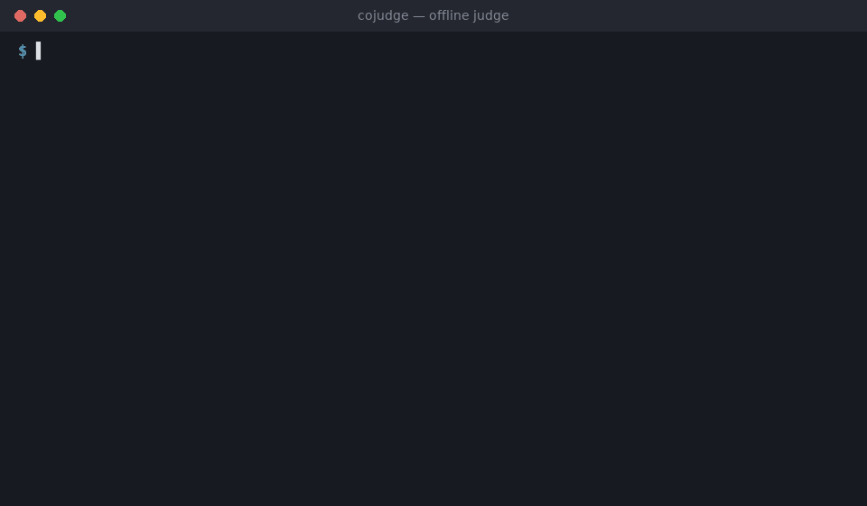
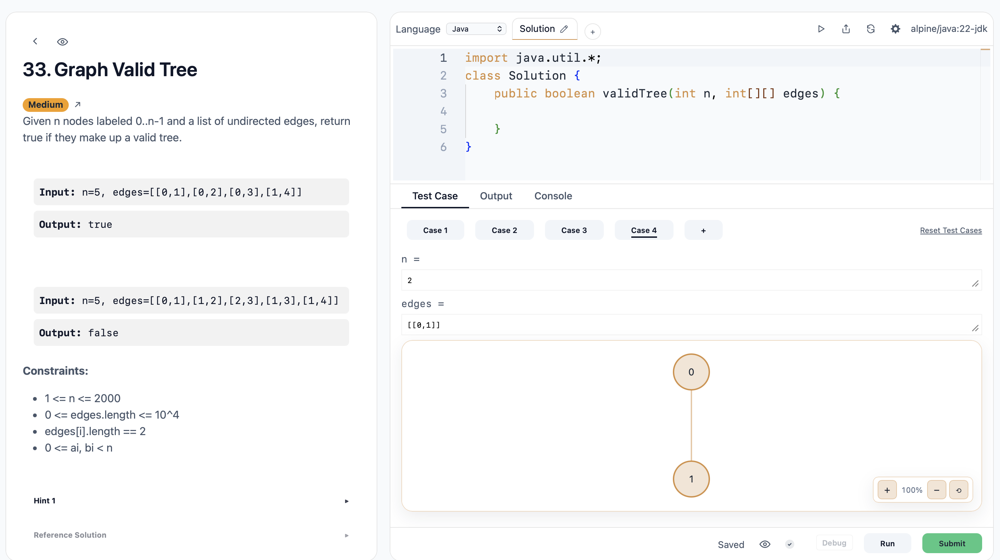
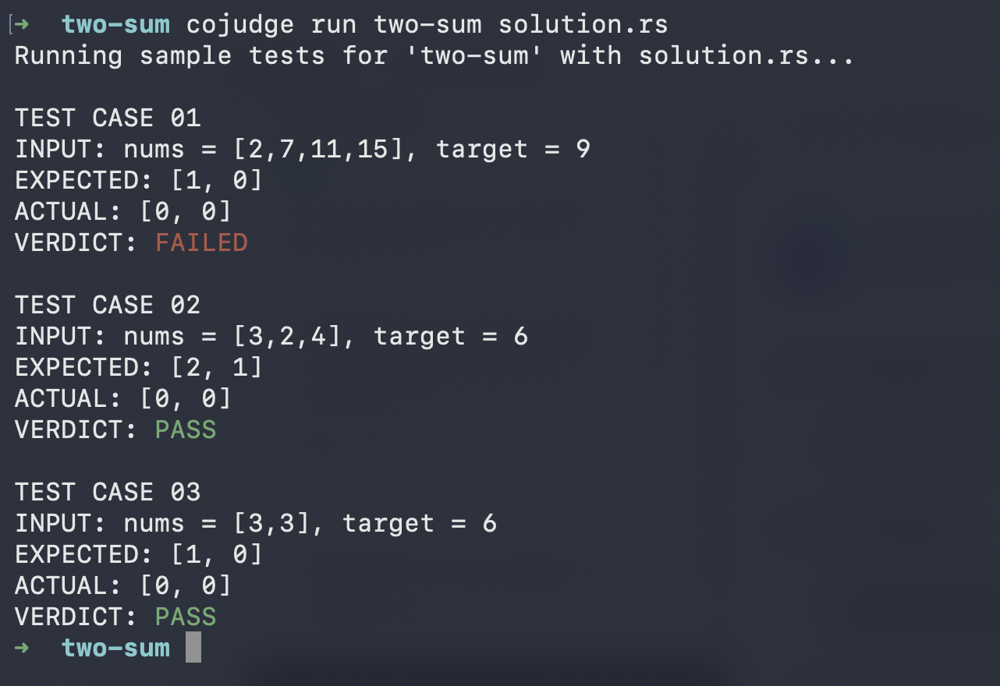
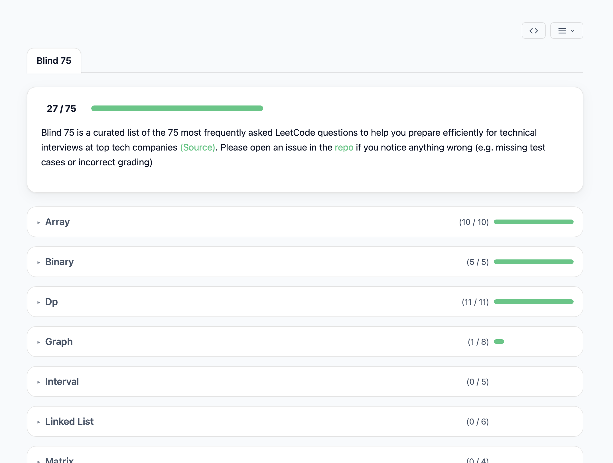
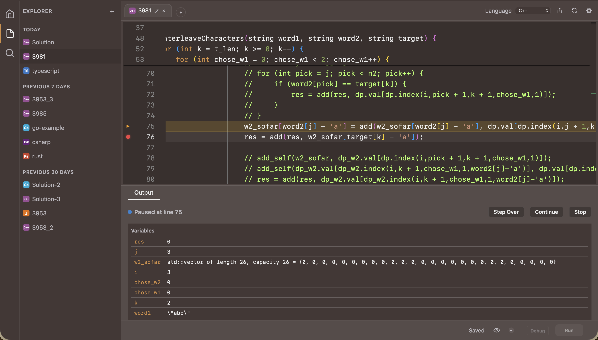
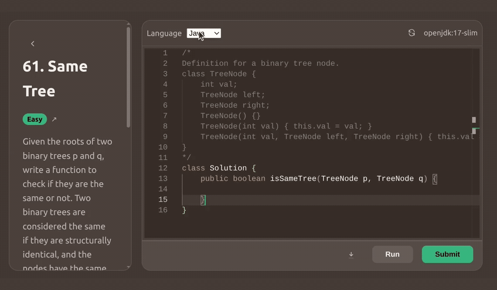

<p align="center">
  <picture>
    <source media="(prefers-color-scheme: dark)" srcset="src-tauri/icons/Square71x71Logo-white.png">
    
  </picture>
</p>

<h1 align="center">Cojudge</h1>

<p align="center"><b>1,000+ problems · 8 languages · offline</b></p>

<p align="center">Practice coding interviews with a local judge. No AI assistant, no discussion forum, no internet. Just you, the problem and the judge.</p>

<p align="center">
  <a href="https://github.com/cojudge/cojudge/actions/workflows/test.yml"></a>
  <a href="https://github.com/cojudge/cojudge/releases"></a>
  <a href="https://opensource.org/licenses/MIT"></a>
  <a href="https://github.com/cojudge/cojudge"></a>
</p>

<p align="center">
  
</p>

<p align="center"><a href="https://cojudge.cloud"><b>Try the demo at cojudge.cloud</b></a> · <a href="#install">Install</a> · <a href="#highlights">Highlights</a></p>

## Why Cojudge

- **Honest practice.** Nothing to reach for when a problem gets hard: no AI, no hints tab, no solutions forum (until you open the reference solution yourself).
- **Works anywhere.** On a plane, on a train, on a locked-down network, or with Wi-Fi off on purpose. Everything runs on your machine.
- **A real judge.** 1,000+ problems with sample tests, hidden tests and reference solutions, judged in Docker sandboxes, with a step debugger and a visualizer. All problems are tested for all programming languages we support
- **Free and open source.** MIT-licensed. Your code and progress stay local.

## Install

| Platform | Command |
| --- | --- |
| macOS | `brew tap cojudge/tap && brew install --cask cojudge` |
| Windows | `winget install -e --id Cojudge.Cojudge` |
| Linux | `.deb`, `.rpm` or `.AppImage` from [Releases](https://github.com/cojudge/cojudge/releases) |

You also need [Docker](https://docs.docker.com/get-docker/) running to judge code. Browsing problems works without it. Don't have Docker? Try [cojudge.cloud](https://cojudge.cloud) first. More options (CLI-only, from source, containerized) are in [Quickstart](#quickstart).

## Screenshots

| |  |
|:---:|:---:|
| Problem view | CLI |
| |  |
| Progress tracker | Debugger |



## Highlights

- **1,031 problems**, each with sample tests, hidden tests and a reference solution, organized into packs: Blind 75, NeetCode 150, NeetCode 250, Basic 50 and a 1,000-problem pack
- **8 languages for every problem**: Java, C++, Python, TypeScript, Rust, C#, Go and PHP
- **Debugger** for all 8 languages, plus a data-structure visualizer
- **Custom test cases**: add your own inputs and compare the expected output with yours
- **Dynamic judging**: each problem can use custom `isCorrect(output)` logic, so any valid answer passes, not just one exact string
- **Docker sandboxes**: consistent, isolated runs on every machine
- **Desktop app and CLI**: native app for macOS, Windows and Linux, plus `cojudge init / run / submit` from your own editor
- **Code playground**: run snippets in any of the 8 languages without a problem
- **Progress tracking** and browser-like tabs for your solutions, stored locally
- **Optional cloud sync** through Google sign-in; local storage stays the source of truth offline
- **Extensible**: add problems by dropping folders into `~/cojudge/problems/`

*Cojudge is a practice judge with a curated set of tests, not a replacement for a full online judge. Practice offline, then run a full submission online when you're ready.*

## Requirements

- Node.js (v18+) and npm for CLI or source installs; desktop releases bundle Node.js
- Docker (installed and running, only required while judging)

## Quickstart

### 1. Installation

#### Desktop app
Desktop builds bundle Node.js; Docker is only required when running, submitting, or debugging code. After installing the app, open the homepage menu and choose **CLI** to put `cojudge` on your PATH (no separate Node.js install).

- **macOS** (Homebrew):
  ```bash
  brew tap cojudge/tap
  brew install --cask cojudge
  xattr -dr com.apple.quarantine /Applications/Cojudge.app
  ```
  The `xattr` step is required on first install (ad-hoc signed, not yet notarized). Update with `brew upgrade --cask cojudge`. Or grab the `.dmg` directly from [GitHub Releases](https://github.com/cojudge/cojudge/releases).
- **Windows** (winget):
  ```powershell
  winget install -e --id Cojudge.Cojudge
  ```
  Update with `winget upgrade Cojudge.Cojudge`. Or grab the `-setup.exe` from [GitHub Releases](https://github.com/cojudge/cojudge/releases).
- **Linux**: download the `.deb`, `.rpm`, or `.AppImage` from [GitHub Releases](https://github.com/cojudge/cojudge/releases) — per-distro install commands are in the release notes.

#### CLI
If you are not using the desktop app, the easiest way to install the `cojudge` CLI without dealing with NPM permission issues is to run our install script:

#### Mac / Linux
```bash
git clone https://github.com/cojudge/cojudge
cd cojudge
./install.sh
source ~/.zshrc # or ~/.bashrc, depending on your shell
```

#### Windows Powershell
```powershell
git clone https://github.com/cojudge/cojudge
cd cojudge
./install.ps1
. $PROFILE
```

This will install dependencies, build the app, and add a `cojudge` alias to your shell configuration.

### 2. Usage
Open the installed desktop app, or run `cojudge` to start the server and open it in your browser:
```bash
cojudge
```

### CLI Commands
| Command | Description |
| --- | --- |
| `cojudge` | Start server & open browser |
| `cojudge <slug> <file>` | Open specific problem in browser with local file |
| `cojudge init <slug> [--lang <lang>] [--output <filename>]` | Initialize a problem file with starter code with filename. Fall back to, for example `solution.rs`, if `filename` is not provided |
| `cojudge run <slug> <file>` | Run sample tests for a problem from CLI (require running Docker) |
| `cojudge submit <slug> <file>`| Submit code for a problem from CLI (require running Docker) |
| `cojudge run <file>` | Run a playground file from CLI (require running Docker) |
| `cojudge list` | List all available problem slugs |
| `cojudge mark <slug>` | Mark a problem as solved |
| `cojudge unmark <slug>` | Unmark a problem as solved |
| `cojudge -p, --port <port>` | Start server on specific port (default 5375) |
| `cojudge -s, --status` | Check if server is running |
| `cojudge -u, --update` | Update to latest version (git pull, or check GitHub Releases in the desktop CLI) |
| `cojudge update` | Same as `--update` |
| `cojudge -l, --logs` | Stream the server logs |
| `cojudge -k, --kill` | Stop the server |
| `cojudge -v, --version` | Show current version & age |
| `cojudge version` | Same as `--version` |
| `cojudge -h, --help` | Show help message |

**Note:** You can browse problems and organize solutions without Docker. Docker is only required when you actually want to `Run` or `Submit` code, either from the web UI or CLI.

### Manual Global Installation (If you prefer)
If you'd rather install it globally via NPM and have the necessary permissions:
```bash
npm install -g .
```

### Troubleshooting Installation (Permission Denied)

If you encounter an `EACCES` error when running `npm install -g .` (especially on macOS with Homebrew), it's likely because your user doesn't have permissions to write to the global `node_modules` folder.

You can fix this by either:
1. **Using sudo** (not recommended but fast):
   ```bash
   sudo npm install -g .
   ```
2. **Fixing npm permissions** (recommended): Follow the [official npm guide](https://docs.npmjs.com/resolving-eacces-permissions-errors-when-installing-packages-globally) to change npm's default directory.
3. **Using the install script** (easiest): Use `./install.sh` as described in the Quickstart section.

## Alternative: Manual Run
If you don't want to install the CLI:
```bash
chmod +x run.sh
./run.sh
```
This starts the app at: http://localhost:5375.

## Running with Docker (Containerized)

If you prefer to run the entire application inside a Docker container:
```bash
chmod +x docker.sh
./docker.sh
```
This builds a local image named `cojudge` and runs it, mapping the host Docker socket so the judge can spawn sibling containers.

## Desktop Apps

Cojudge can also run as a native Tauri application on macOS, Windows, and Linux. The application bundles its Node.js backend, problems, and courses, so users do not need to install Node.js. Docker is still required when running or debugging code.

See [`docs/DESKTOP.md`](docs/DESKTOP.md) for development, DMG, signing, and notarization instructions.

## Development

1) Add $USER to docker group (if using Docker)
```bash
sudo usermod -aG docker "$USER"
newgrp docker
```

2) Install dependencies
```bash
npm install
```
3) Start the app (dev)
```bash
npm run dev
```

## Add a problem

Local content lives in `~/cojudge` (auto-seeded from the repo's bundled `problems/` + `courses/` on first start; your copy overrides bundled content — edit / add / delete files there, changes apply immediately). Unedited copies auto-update when Cojudge ships fixes; your edits are never overwritten (reset stale "Modified" items in Manage Problems or via `cojudge sync --reset <id>`). Override the location with `COJUDGE_CONTENT_DIR`.

See [`docs/ADD_PROBLEMS.md`](docs/ADD_PROBLEMS.md) for a comprehensive guide covering:

- Required files (`statement.md`, `metadata.json`, `official-tests.json`, `Marker.java`)
- Standard function-based problems vs class-based design problems
- Supported parameter/output types
- Starter code conventions for all languages
- How to write `Marker.java` with the reference solution and `isCorrect` validator
- Registration in `~/cojudge/courses/blind75/courseinfo.json`
- Verification checklist (`cojudge init`/`run`/`submit`)

Refer to `~/cojudge/problems/two-sum` (seeded from `problems/two-sum`) for a minimal example.

#### Note on problems

Some test cases and reference marker solutions were AI‑assisted and human‑reviewed. Issues may remain—please open an issue or PR if you spot anything.

## Add a programming language

This is a more complicated process but it is definitely doable.

1. For starter you need to create a new class that extends class `ProgramRunner.ts` (e.g. `JavascriptRunner.ts`) and implement your own `abstract compile()` and `abstract run()`. It's expected that all runtimes will be executed via [Dockerode](https://github.com/apocas/dockerode)

2. Implement all the `displayOutput({inputType})` and `to_{inputType}()` methods on your custom utilitiy class (e.g. `javascriptUtil.ts`)

3. Add your new languages on `api/image/pull` and `api/image/status`

4. Add `starterCode` to the problem you like to solve in your language. Just the starter code is needed for existing problems. No need for solution in the new language. Our codebase will handle the rest.

5. Update `type ProgrammingLanguage = 'java' | 'python' | 'cpp' | 'your_new_lang'` on `util.ts`;

6. Add a new `<option>` on the UI for the new language in `#language-select`

7. Create a new class that extends `PlaygroundRunner` (e.g. `PlaygroundJavascriptRunner`) in `src/lib/runners/PlaygroundRunners.ts` and add the instantiation logic in `src/routes/api/playground/run/+server.ts`.

Refer to `javaUtil.ts`, `JavaRunner.ts` and `problems/two-sum` (runtime copy: `~/cojudge/problems/two-sum`) for a detailed example.

## Troubleshooting

### Error Connecting to Docker on macOS with Colima

Some Docker environments on macOS (like Colima) use a non-default Docker socket path. If the application has trouble connecting to Docker, you can specify the path manually by setting the `HOST_DOCKER_SOCKET` environment variable.

**Example:**
```bash
# Find your socket path by running `colima status`
HOST_DOCKER_SOCKET="/Users/your-user/.colima/default/docker.sock" ./docker.sh
```

### Docker Not Found on macOS with Orbstack

If you're using [Orbstack](https://orbstack.dev) instead of Docker Desktop, you may need to set the `DOCKER_HOST` environment variable so the app can locate the Docker socket:

```bash
export DOCKER_HOST="unix://$HOME/.orbstack/run/docker.sock"
```

Add this line to your `~/.zshrc` (or `~/.bashrc`) to make it permanent:

## Contact

Feel free to use the [Issue page](https://github.com/cojudge/cojudge/issues) or [Discussion page](https://github.com/cojudge/cojudge/discussions) for any issues, feedback, comments, feature requests, or anything else related to cojudge.
